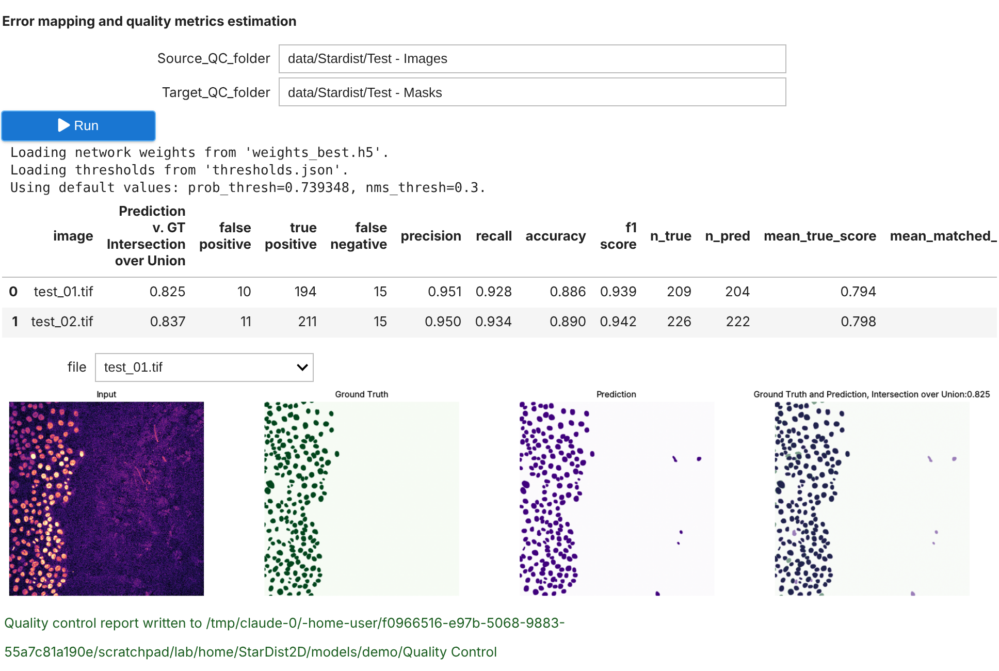

# StarDist2D

Segment star-convex nuclei and cells in 2D images with [StarDist](https://github.com/stardist/stardist): train your own
model, check its quality, export it to the BioImage Model Zoo and predict, from a notebook (locally or on Google Colab)
or directly in **Fiji, napari and QuPath**.

StarDist2D is the [LabConstrictor](https://github.com/CellMigrationLab/LabConstrictor) version of the
[ZeroCostDL4Mic](https://github.com/HenriquesLab/ZeroCostDL4Mic) StarDist 2D notebook (v1.20.8): the same text, the
same steps and parameters, the same output files, with the code moved into the `stardist2d` Python package. What
changed, and every bug fixed on the way, is listed in the [CHANGELOG](CHANGELOG.md).

## How to Download and Install StarDist2D?

The installer would only be available once StarDist2D developer has created a release.
Please, go to [this page](.tools/docs/download_executable.md) and check if the installing instructions are there.
In case there is no documentation there, please [create an issue](https://github.com/CellMigrationLab/Stardist2D/issues) asking the developer to create a release.

Installers: Windows x86_64, macOS Apple Silicon, Linux x86_64. Training uses an NVIDIA GPU on Linux; on Windows and
macOS it runs on the CPU (slow), so train on Colab or [DL4MicEverywhere](https://github.com/HenriquesLab/DL4MicEverywhere)
if you need speed. A model trained anywhere works everywhere for prediction.

## Use it

- **Notebook** (from the app's Welcome page, or on [Colab](https://colab.research.google.com/github/CellMigrationLab/Stardist2D/blob/main/notebooks/StarDist_2D/StarDist_2D_ZeroCostDL4Mic.ipynb)):
  follow sections 1 to 6. Section 3.1 gives a small example dataset even offline (6 training pairs and 2 test pairs
  from [Zenodo 7949940](https://doi.org/10.5281/zenodo.7949940)). Screenshots of a full run: [docs/screenshots](docs/screenshots/README.md).
- **Fiji, napari, QuPath** (with the LabConstrictor plugin of each): pick *StarDist2D* and a tool.

  | Tool | What you get |
  |---|---|
  | Segment nuclei (fluorescence) | label image, outlines (ROI Manager / Shapes layer / annotations), per-object table; channel choice and region runs |
  | Segment nuclei (H&E / RGB) | the same for RGB images with `2D_versatile_he` or your 3-channel model |
  | Segment a folder | the notebook's section 6.1 outputs for every image of a folder |
  | Quality control | your model's prediction compared with a ground-truth mask |
  | Train a model | a model trained on your folders of images and masks (sections 3-4 of the notebook), from scratch or from a pretrained model; loss table, validation F1 and the model folder |
  | Quality control on a folder | section 5 of the notebook for a model you trained: QC table, F1 summary, predictions |
  | Check this installation | memory, disk, GPU and TensorFlow of the app |

  Models: `2D_versatile_fluo`, `2D_versatile_he`, `2D_paper_dsb2018` (downloaded once), or the folder of a model you
  trained (in the notebook or with *Train a model*).

  **Training from Fiji, napari or QuPath.** *Train a model* writes the same model folder as the notebook. Progress is
  shown after every epoch. *Cancel* stops within a batch and keeps what was saved: the best weights so far, the loss
  table, and `stardist2d_run.json`, which says where training stopped. Such a model works with StarDist's default
  thresholds. Windows and macOS train on the CPU, so start with a few epochs; train long models in the notebook on
  Colab or on a Linux computer with an NVIDIA GPU.
- **Command line**: `python -m stardist2d train|qc|predict ...` (see `python -m stardist2d --help`).

## Credits

StarDist: Schmidt, Weigert, Broaddus & Myers, MICCAI 2018. ZeroCostDL4Mic: von Chamier, Laine et al., Nature
Communications 2021. The installer images use the StarDist logo (BSD 3-Clause, see [app/logo](app/logo/README.md)).

## Documentation for StarDist2D's Developers

- How the code is organised and the rules it follows (MorphoBricks code standard): [AGENTS.md](AGENTS.md).
- Checks before a pull request: `python tools/check.py` (tests, shared code rules, Ruff). The notebook is generated:
  `python tools/build_notebook.py`. The Fiji / napari / QuPath tools: `labconstrictor-tools test --module stardist2d_lc_tools --pythonpath src --cases lc_tests/cases.json`.
- The plan and its decisions: [docs/plan.md](docs/plan.md).
- Internal documentation on how to upload notebooks or create executables is available in the [.tools/docs](.tools/docs/README.md) folder.
